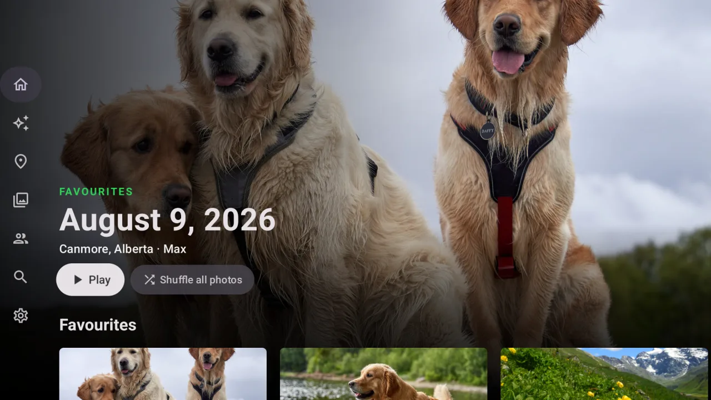
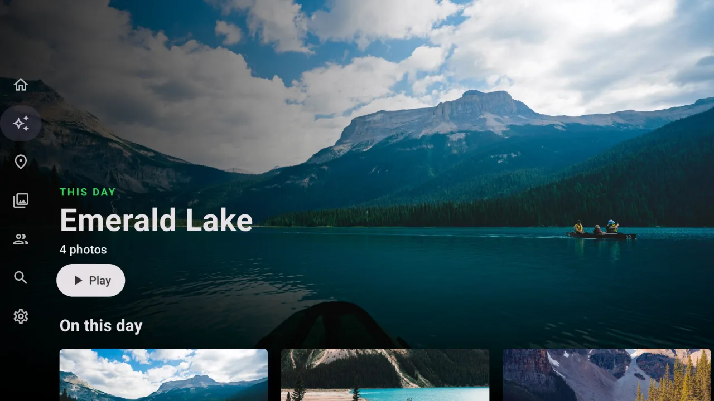
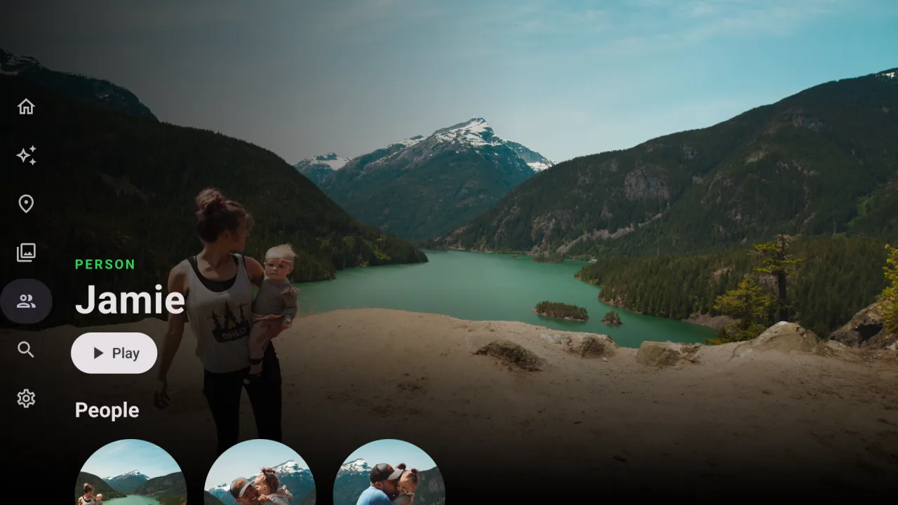
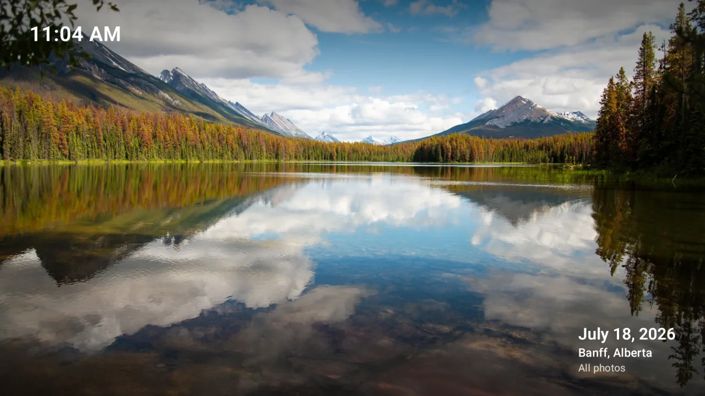

<p align="center">
  <a href="https://frameleaf.app">
    
  </a>
</p>

<h1 align="center">Frameleaf</h1>

<p align="center">
  <strong>Your photos. Your server. Everywhere.</strong><br>
  A self-hosted photo and video library: bring a lifetime of photos home, find any moment, edit it, and enjoy it on your phone, in any browser and on the TV.
</p>

<p align="center">
  <a href="https://apps.apple.com/us/app/frameleaf/id6821111014"></a>
  &nbsp;
  <a href="https://play.google.com/store/apps/details?id=app.frameleaf.android"></a>
</p>

<p align="center">
  <a href="https://frameleaf.app">Website</a> ·
  <a href="https://frameleaf.app/help/">Help Center</a> ·
  <a href="https://frameleaf.app/docs/start/introduction/">Docs</a> ·
  <a href="https://frameleaf.app/docs/start/install/">Install</a> ·
  <a href="https://frameleaf.app/platform/">Features</a> ·
  <a href="https://frameleaf.app/demo/">Demo</a> ·
  <a href="https://frameleaf.app/ask/">Ask Frameleaf</a> ·
  <a href="https://frameleaf.app/docs/help/faq/">FAQ</a>
</p>

---

> [!WARNING]
> **Frameleaf is in BETA testing and under heavy development.** Expect bugs, breaking changes and incomplete features. Keep independent backups of your photos and videos, and don't rely on Frameleaf as the only copy of your library.

<p align="center">
  
</p>

## What's new in Frameleaf

*November 2026.* The newest additions, most recent first. Release by release, see the [release notes](https://github.com/Frameleaf/frameleaf-app/releases).

<table>
  <tr>
    <td width="50%"><a href="https://frameleaf.app/docs/using/date-and-time-doctor/"></a><br><sub><b>Date & Time Doctor</b> — finds wrong clocks, time zones and missing dates, shows before and after, and fixes a whole group with Undo</sub></td>
    <td width="50%"><a href="https://frameleaf.app/docs/using/connect-ai-agents/"></a><br><sub><b>Frameleaf Assistant & connected apps</b> — ask about your library, or let Claude, ChatGPT and Home Assistant work with it, on your terms</sub></td>
  </tr>
  <tr>
    <td width="50%"><a href="https://frameleaf.app/docs/using/account-activity/"></a><br><sub><b>Account activity & two-step sign-in</b> — every sign-in and change to your account, a code from your phone after your password, and passkeys</sub></td>
    <td width="50%"><a href="https://frameleaf.app/docs/admin/jobs/"></a><br><sub><b>Background work you can read</b> — new uploads go first, and Advanced says what went wrong and what to do about it</sub></td>
  </tr>
  <tr>
    <td width="50%"><a href="https://frameleaf.app/docs/using/search-models/"></a><br><sub><b>Search quality slider</b> — pick Good, Better or Best for search, faces and descriptions, and see what each costs your hardware</sub></td>
    <td width="50%"><a href="https://frameleaf.app/docs/admin/manager/"></a><br><sub><b>Frameleaf Manager</b> — a Containers page, automatic updates, and choosing your folders on Unraid, TrueNAS and plain Docker</sub></td>
  </tr>
</table>

Also new:

- **[Frameleaf Desktop](https://frameleaf.app/docs/apps/desktop/)** for Mac, Windows and Linux, which can lend its graphics card to your server.
- **[Tidy up](https://frameleaf.app/docs/using/tidy-up/)** suggests memes, receipts and screenshots for the Archive, and **[Album cleanup](https://frameleaf.app/docs/using/tidy-your-albums/)** merges duplicate albums. Nothing is deleted.
- **[Identical files](https://frameleaf.app/docs/admin/physical-deduplication/)** are stored once automatically, with Undo.
- **[Damaged and missing files](https://frameleaf.app/docs/using/damaged-and-missing-files/)** are found, repaired from a good copy where there is one, and listed with what was tried.
- **[Switch from other photo apps](https://frameleaf.app/docs/migrate/from-other-photo-apps/)** (Beta): PhotoPrism, Photoview, PiGallery2, Lychee, Nextcloud, Piwigo, LibrePhotos and Ente. iCloud Photos is built in.
- **[Locked encryption](https://frameleaf.app/docs/using/locked-encryption/)** — optionally encrypt your Locked photos with a PIN or passphrase.
- **Computers at home** can work on everyone's photos, and [each person chooses](https://frameleaf.app/docs/using/account-settings/#where-your-photos-are-processed) whether theirs may use Frameleaf Cloud.
- **For photographers:** a [RAW editor](https://frameleaf.app/docs/using/raw-develop/), [Clients](https://frameleaf.app/docs/using/clients/), [client galleries](https://frameleaf.app/docs/using/client-galleries/) and a [studio website](https://frameleaf.app/docs/using/studio-website/).
- **More formats:** Log and 360 video, wider RAW support, and design files and fonts in Boards. [Supported formats](https://frameleaf.app/docs/help/supported-formats/)

## What is Frameleaf?

Frameleaf runs on your NAS, home server or any Linux machine with Docker. Your originals stay as ordinary files on your own disks, faces and search are worked out on your own hardware, and there's no telemetry. No subscription or cloud account required.

One library, every screen:

- **Server and web app** — the Frameleaf Library and its API (open source, AGPLv3).
- **iPhone and iPad** — native app with backup, a built-in editor, widgets, Siri and Live Activities.
- **iPhone Duo** — fold-aware layouts, Compare, Frame mode and multiple windows.
- **Android** — native app with backup, offline library, editor and Google Cast.
- **Mac, Windows and Linux** — Frameleaf Desktop, which can also help your server with heavy work.
- **Apple TV and Android TV** — browse, play memories as shows, and turn your TV into a photo frame.
- **Frameleaf Cloud** *(optional)* — encrypted remote access, off-site backup and cloud GPU processing.

➡️ Read more in [What is Frameleaf?](https://frameleaf.app/docs/start/introduction/), browse [every feature](https://frameleaf.app/platform/), or [try the demo](https://frameleaf.app/demo/) in your browser.

## Your library

Every photo and video your family has taken, in one place that stays fast at any size.

- **Library & timeline** — years, months and days as cover cards; albums, folders, stacks, tags, RAW, Live and Motion Photos. [Docs](https://frameleaf.app/docs/using/library/)
- **Three layouts** — Timeline, a dense Browse grid, and Work for culling a shoot with stars and rejects.
- **Best photos** — your sharpest, best-exposed shots, scored privately on your server.
- **Change hundreds at once** — dates, places, tags, albums and stacks from one selection bar, a right-click menu, and [keyboard shortcuts](https://frameleaf.app/docs/using/library/#keyboard-shortcuts) for everything.
- **Tags** — nested, coloured, and browsable as cards on their own page. [Docs](https://frameleaf.app/docs/using/tags/)
- **Video that scrubs** — preview thumbnails on the seek bar, and live seeking as you drag. [Docs](https://frameleaf.app/docs/using/video-previews/)
- **Originals never change** — edits to dates, ratings and places go to the database and XMP sidecars.
- **Bring everything home** — import a Google Photos Takeout, sync iCloud Photos in the background, add folders already on your disks, [switch from another photo app](https://frameleaf.app/docs/migrate/from-another-library/), or [move a whole library to a new server](https://frameleaf.app/docs/admin/move-to-a-new-server/).

<p align="center">
  
</p>

## Find and rediscover

Search the way you remember, and let the library bring old moments back to you.

- **Ask in plain words** — "photos of Alice in Banff last summer" becomes the right filters. [Docs](https://frameleaf.app/docs/using/search/)
- **Text in photos and spoken words** — signs, receipts and screenshots, plus what was said in your videos, played from that moment. [Docs](https://frameleaf.app/docs/using/spoken-words/)
- **People & pets** — faces and pets recognised on your own server. Name someone once and find every moment with them. [Docs](https://frameleaf.app/docs/using/people/)
- **Memories, places & landmarks** — on this day, trips, a world map, and "A day at…" memories for the parks and museums you visited. [Docs](https://frameleaf.app/docs/using/memories/)
- **AI descriptions & smart albums** — optional on-server captions and tags that use the names of people you know, and albums for Travel, Receipts, Pets and more that fill themselves. [Docs](https://frameleaf.app/docs/using/ai-descriptions/)
- **Explore** — familiar faces, favourite places, documents and a few photos worth another look.

<table>
  <tr>
    <td width="50%"><br><sub><b>Search</b> — describe what you remember</sub></td>
    <td width="50%"><br><sub><b>People & pets</b> — recognised on your own hardware</sub></td>
  </tr>
  <tr>
    <td width="50%"><br><sub><b>Explore</b> — what you forgot you had</sub></td>
    <td width="50%"><br><sub><b>Places</b> — countries, cities and landmarks</sub></td>
  </tr>
  <tr>
    <td width="50%"><br><sub><b>Memories</b> — moments resurfaced</sub></td>
    <td width="50%"><br><sub><b>AI descriptions</b> — a caption and tags for every photo and video</sub></td>
  </tr>
</table>

## Create

A photo editor, a video editor and a design workspace, all over the same library.

### Photo editor

Light, colour, crop, masks, looks and RAW development, saved as a new version beside the untouched original — on web, iPhone and Android. RAW photos open in the [RAW editor](https://frameleaf.app/docs/using/raw-develop/). Or [edit in another app](https://frameleaf.app/docs/using/editing/#edit-in-another-app) and bring the results back as versions. [Docs](https://frameleaf.app/docs/using/editing/)

<p align="center">
  
</p>

### Studio

A real video editor inside your photo library. [Make a movie](https://frameleaf.app/docs/studio/make-a-movie/) from an album in one step, or edit on a multitrack timeline: colour wheels and scopes, [edit by transcript](https://frameleaf.app/docs/studio/edit-by-transcript/), word-by-word captions in eleven languages, music written for your film, [stabilising](https://frameleaf.app/docs/studio/stabilise/), [voice clean-up](https://frameleaf.app/docs/studio/clean-up-voice/), [subject cut-out](https://frameleaf.app/docs/studio/cut-out/), restoration for old footage, and vertical or square exports that follow faces — all rendered on your own hardware. [Studio guide](https://frameleaf.app/docs/studio/overview/)

<table>
  <tr>
    <td width="50%"><br><sub><b>Timeline editing</b> — titles, video, camera audio and music on their own tracks</sub></td>
    <td width="50%"><br><sub><b>Colour grading</b> — wheels, curves, LUTs and scopes</sub></td>
  </tr>
  <tr>
    <td width="50%"><br><sub><b>Edit by transcript</b> — delete the words, Studio cuts the film</sub></td>
    <td width="50%"><br><sub><b>Cut out the subject</b> — blur, remove or replace the background</sub></td>
  </tr>
  <tr>
    <td width="50%"><br><sub><b>Captions</b> — every word lights up as it's said</sub></td>
    <td width="50%"><br><sub><b>Restoration</b> — give old footage another look</sub></td>
  </tr>
</table>

### Boards

A free workspace for references, mood boards and design files, on the same server as your photos. Save images, videos, design files and links; nest collections as deep as you like; find anything by colour, type, shape or source; annotate without touching the file; save from the web with the **Save to Frameleaf** Chrome extension; and import from Eagle. [Boards](https://frameleaf.app/boards/)

<table>
  <tr>
    <td width="50%"><br><sub><b>Collections</b> — as deep as the project</sub></td>
    <td width="50%"><br><sub><b>Annotations</b> — drawn over the picture, not into it</sub></td>
  </tr>
</table>

### Clients

For photography studios: bring shoots into projects, cull and develop RAW files, proof with clients in branded, password-protected galleries, and deliver the exact version they approved — then publish a portfolio website. [Frameleaf for photographers](https://frameleaf.app/photographers/) · [Clients guide](https://frameleaf.app/docs/using/clients/)

<table>
  <tr>
    <td width="50%"><br><sub><b>Projects</b> — every shoot and its next step</sub></td>
    <td width="50%"><br><sub><b>Proofing</b> — favourites and notes from your client</sub></td>
  </tr>
</table>

## Share with the people who were there

Give each person their own library, then share exactly as much as you mean to.

- **Partner sharing** — see each other's photos in your own timeline. [Docs](https://frameleaf.app/docs/using/sharing/)
- **Albums & shared spaces** — nested albums with custom icons, and shared spaces with roles. [Docs](https://frameleaf.app/docs/using/albums/)
- **Links** — with passwords, expiry and download control.
- **A library for everyone** — separate accounts with their own albums, favourites and storage limits; family copies of the same file are stored once.
- **Casting** — Google Cast from web and Android, and Play on TV from iPhone or Android to Apple TV and Android TV. [Docs](https://frameleaf.app/docs/using/casting/)

## Keep it safe and tidy

Photos are a forty-year project. Frameleaf looks after the files and the people in them.

- **Library Care** — review photo and video duplicates side by side (preferring RAW, then HEIC, over a re-encoded JPG), and find, check and relink missing or damaged originals with evidence before anything changes. [Docs](https://frameleaf.app/docs/using/library-care/)
- **Date & Time Doctor** — finds photos in the wrong place on the timeline and fixes them a group at a time, with Undo for 30 days. [Docs](https://frameleaf.app/docs/using/date-and-time-doctor/)
- **Tidy up** — clutter such as memes, receipts and screenshots is suggested for the Archive; nothing is deleted. [Docs](https://frameleaf.app/docs/using/tidy-up/)
- **Locked content** — lock sensitive photos behind your PIN, with rules by tag or person, and optional [encryption](https://frameleaf.app/docs/using/locked-encryption/). [Docs](https://frameleaf.app/docs/using/private-content/)
- **Safe sign-in** — passkeys, [two-step sign-in](https://frameleaf.app/docs/using/two-step-sign-in/), and an [account activity](https://frameleaf.app/docs/using/account-activity/) page that shows every sign-in and change.
- **Backup** — encrypted off-site Cloud backup, Buddy backup to a friend's server, and automatic database backups with a guided restore. [Docs](https://frameleaf.app/docs/admin/backup-and-restore/)
- **A patient trash** — deleted items wait 30 days, and come back with their albums and tags.

<table>
  <tr>
    <td width="50%"><br><sub><b>Duplicate review</b> — side by side, best copy suggested</sub></td>
    <td width="50%"><br><sub><b>Backups</b> — local, Cloud and Buddy backup</sub></td>
  </tr>
  <tr>
    <td width="50%"><br><sub><b>Library care</b> — file checks, things to fix, tidy up and duplicates in one place</sub></td>
    <td width="50%"><br><sub><b>Date & Time Doctor</b> — the old time crossed out, the right one below</sub></td>
  </tr>
</table>

## Run it your way

A server that looks after itself, with settings written for people, not operators.

- **Command Center** — health, storage, jobs, users and library analytics in one place. [Docs](https://frameleaf.app/docs/admin/command-center/)
- **Where work runs** — share heavy work with the desktops in your home, then Frameleaf Cloud GPU when you choose. You set the order. [Docs](https://frameleaf.app/docs/admin/workers/)
- **Quiet daytime, busy nights** — heavy work waits for the overnight schedule so browsing stays fast; new uploads are always processed first. [Docs](https://frameleaf.app/docs/admin/jobs/)
- **Connected apps** — let an AI assistant or Home Assistant into your library, each with its own limits, and see what it did. [Docs](https://frameleaf.app/docs/admin/connected-apps/)
- **Workflows** — add matching photos to albums or tag them, after uploads or on a schedule. [Docs](https://frameleaf.app/docs/admin/workflows/)
- **Hardware acceleration** — for AI and video, with a CPU fallback.
- **In-app help** — help for the screen you're on, and [Ask Frameleaf](https://frameleaf.app/docs/help/ask-frameleaf/) for anything else.

<table>
  <tr>
    <td width="50%"><br><sub><b>Command Center</b> — your server at a glance</sub></td>
    <td width="50%"><br><sub><b>Where work runs</b> — this server, home computers, then Cloud</sub></td>
  </tr>
  <tr>
    <td width="50%"><br><sub><b>Background work</b> — pace, overnight work and each feature's state</sub></td>
    <td width="50%"><br><sub><b>Activity log</b> — sign-ins, sharing and connected apps for every account</sub></td>
  </tr>
</table>

## Apps

### iPhone, iPad and Android

Back up your camera roll to your own server, check every photo arrived safely, free up space, and carry your whole library with you — at home, away or offline. Sign in with Frameleaf, find servers on your Wi-Fi automatically, or set up a brand-new server straight from your phone.

<p align="center">
  
  
  
  
</p>
<p align="center">
  
  
  
  
</p>

[iPhone and iPad](https://frameleaf.app/docs/apps/iphone/) (iOS 26+) · [Android](https://frameleaf.app/docs/apps/android/) (Android 11+)

### iPhone Duo

Frameleaf reads the fold and lays your library out around it: open it like a book to see a photo beside the grid or compare two photos, prop it up to edit, turn any album into a desk photo frame with **Frame**, and drag photos between two windows.

<table>
  <tr>
    <td width="50%"><br><sub><b>Library</b> — grid and photo side by side</sub></td>
    <td width="50%"><br><sub><b>Editor</b> — photo above the fold, controls below</sub></td>
  </tr>
</table>

[iPhone Duo and wide windows](https://frameleaf.app/docs/apps/iphone-duo/)

### Apple TV

Your memories on the biggest screen in the house. Browse Home, Memories, Places, Albums, People and Search from the couch, play memories as shows with title cards and music, or leave a slideshow running as a photo frame. Pick something on your iPhone and choose **Play on Apple TV**.

<table>
  <tr>
    <td width="50%"><br><sub><b>Home</b> — favourites, best photos, memories and places</sub></td>
    <td width="50%"><br><sub><b>Memories</b> — played as shows</sub></td>
  </tr>
  <tr>
    <td width="50%"><br><sub><b>People</b> — everyone, on the big screen</sub></td>
    <td width="50%"><br><sub><b>Slideshow</b> — your TV as a photo frame</sub></td>
  </tr>
</table>

[Apple TV](https://frameleaf.app/docs/apps/apple-tv/) (tvOS 26+, uses Frameleaf Cloud remote access)

### Android TV

The same couch experience on Android TV and Google TV. Sign in by scanning a code with your phone, browse from the side rail, play memories as shows with music, or leave a slideshow running with the clock. Frameleaf shows up as a channel on the home screen, and **Play on TV** works from both iPhone and Android.

<table>
  <tr>
    <td width="50%"><br><sub><b>Home</b> — favourites, best photos, memories and places</sub></td>
    <td width="50%"><br><sub><b>Memories</b> — on this day, trips and years in review</sub></td>
  </tr>
  <tr>
    <td width="50%"><br><sub><b>People</b> — everyone, and every pet, on the big screen</sub></td>
    <td width="50%"><br><sub><b>Slideshow</b> — your TV as a photo frame</sub></td>
  </tr>
</table>

[Android TV](https://frameleaf.app/apps/android-tv/) (Android TV 11+), uses Frameleaf Cloud sign-in and connects to your server at home first, then directly or through Frameleaf Cloud remote access.

## Get started

1. **Check the [requirements](https://frameleaf.app/docs/start/requirements/)** — Linux with Docker and Docker Compose v2. Not sure what your GPU can run? [Ask Frameleaf](https://frameleaf.app/ask/) or see [Choose processing for your hardware](https://frameleaf.app/docs/help/choose-processing/).
2. **Install** with one of:
   - [**Frameleaf Manager**](https://frameleaf.app/docs/start/install/) — guided install and upgrades (recommended).
   - [**Docker Compose**](https://frameleaf.app/docs/start/manual-install/) — for experienced administrators.
   - **NAS apps** — [Unraid](https://frameleaf.app/docs/nas/unraid/), [Synology](https://frameleaf.app/docs/nas/synology/), [TrueNAS](https://frameleaf.app/docs/nas/truenas/) and [HexOS](https://frameleaf.app/docs/nas/hexos/).
3. **Open** `http://<server-ip>:2283`, or set the server up from the iPhone or Android app on the same Wi-Fi, then follow [First steps after installing](https://frameleaf.app/docs/start/first-steps/).

### Quick start with Docker Compose

```bash
mkdir frameleaf-app && cd frameleaf-app
curl -fL -o docker-compose.yml https://github.com/Frameleaf/frameleaf-app/releases/latest/download/docker-compose.yml
curl -fL -o .env https://github.com/Frameleaf/frameleaf-app/releases/latest/download/example.env
docker compose up -d
```

Edit `.env` first if you want your photos (`UPLOAD_LOCATION`) or database (`DB_DATA_LOCATION`) somewhere other than the current folder. To upgrade later, run `docker compose pull && docker compose up -d` — see [Upgrading](https://frameleaf.app/docs/admin/upgrading/).

> [!TIP]
> Your library on one server is a single copy. Protect it with [Cloud backup](https://frameleaf.app/docs/cloud/cloud-backup/), [Buddy backup](https://frameleaf.app/docs/cloud/buddy-backup/) or your own copies — see [Backup and restore](https://frameleaf.app/docs/admin/backup-and-restore/).

### Switching from another service?

- [Switch from your existing photo server](https://frameleaf.app/docs/migrate/from-immich/)
- [Import from iCloud Photos](https://frameleaf.app/docs/migrate/icloud-photos/) or [keep iCloud Photos in sync](https://frameleaf.app/docs/migrate/icloud-photos-sync/)
- [Import from Google Photos](https://frameleaf.app/docs/migrate/google-photos/)
- [Import from a folder](https://frameleaf.app/docs/migrate/from-a-folder/), or [try Frameleaf without moving your photos](https://frameleaf.app/docs/migrate/try-without-moving-your-photos/)
- [Switch from PhotoPrism, Nextcloud, Ente and other photo apps](https://frameleaf.app/docs/migrate/from-other-photo-apps/) (Beta)

## Frameleaf Cloud (optional)

Self-hosting is free. [Frameleaf Cloud](https://frameleaf.app/docs/cloud/overview/) adds:

- 🌐 [Remote access](https://frameleaf.app/docs/cloud/remote-access/) — encrypted access from anywhere, for the apps, Apple TV and Android TV
- ☁️ [Cloud backup](https://frameleaf.app/docs/cloud/cloud-backup/) — off-site backup
- ⚡ [Cloud GPU](https://frameleaf.app/docs/cloud/cloud-gpu/) — run heavy AI jobs without local hardware

A Server licence on its own gives your server a Frameleaf direct address for remote access, and lets it trade backups with a friend's licensed server through [Buddy backup](https://frameleaf.app/docs/cloud/buddy-backup/) over a direct connection; Frameleaf Cloud adds the relay when a direct connection isn't possible. See [frameleaf.app](https://frameleaf.app/pricing/) for current pricing.

## Docs and help

The [Frameleaf docs and help center](https://frameleaf.app/docs/start/introduction/) cover everything from first install to the API.

| Topic | Where |
|---|---|
| Using Frameleaf | [Library, search, sharing, editing…](https://frameleaf.app/docs/using/library/) |
| Apps | [iPhone and iPad](https://frameleaf.app/docs/apps/iphone/) · [iPhone Duo](https://frameleaf.app/docs/apps/iphone-duo/) · [Android](https://frameleaf.app/docs/apps/android/) · [Desktop](https://frameleaf.app/docs/apps/desktop/) · [Apple TV](https://frameleaf.app/docs/apps/apple-tv/) · [Android TV](https://frameleaf.app/apps/android-tv/) |
| Studio | [Video editing guide](https://frameleaf.app/docs/studio/overview/) |
| Boards and Clients | [Boards](https://frameleaf.app/docs/using/boards/) · [Clients](https://frameleaf.app/docs/using/clients/) · [RAW editor](https://frameleaf.app/docs/using/raw-develop/) · [Frameleaf for photographers](https://frameleaf.app/photographers/) |
| Running your server | [Command Center, settings, upgrades…](https://frameleaf.app/docs/admin/command-center/) |
| Frameleaf Cloud | [Remote access, backup and GPU](https://frameleaf.app/docs/cloud/overview/) |
| Server API | [API overview](https://frameleaf.app/docs/api/overview/) |
| Help | [Help Center](https://frameleaf.app/help/) · [Ask Frameleaf](https://frameleaf.app/ask/) · [FAQ](https://frameleaf.app/docs/help/faq/) · [Troubleshooting](https://frameleaf.app/docs/help/troubleshooting/) · [Supported formats](https://frameleaf.app/docs/help/supported-formats/) |

## License

The Frameleaf Library server is open source under the [GNU AGPLv3](LICENSE).
